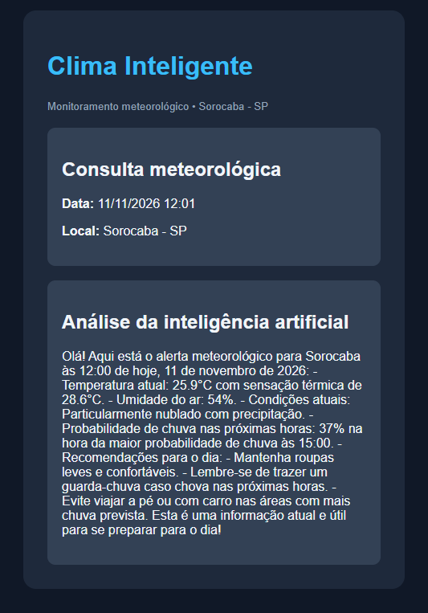

# 🌦️ Assistente Inteligente - Sorocaba

Assistente meteorológico que utiliza inteligência artificial local para interpretar dados climáticos e gerar análises automáticas de Sorocaba - SP.

## 🖥️ Demonstração



## 🚀 Tecnologias utilizadas

- **n8n:** Automação do fluxo.
- **Ollama:** Execução local de inteligência artificial.
- **Qwen 2.5:3b:** Modelo de linguagem.
- **Open-Meteo:** API de dados meteorológicos.
- **HTML/CSS:** Geração de relatório visual.

## ⚙️ Como funciona

1. O n8n executa a consulta meteorológica automaticamente.
2. A API Open-Meteo fornece os dados climáticos.
3. O modelo Qwen analisa as informações.
4. O fluxo organiza a resposta e gera um relatório HTML.

## 🎯 Objetivo

Demonstrar a integração entre automação, APIs e inteligência artificial local na construção de um assistente inteligente.

## 👨‍💻 Autor

Projeto desenvolvido para fins de estudo e portfólio na área de AI Agent Builder.

## ⚙️ Como executar o projeto

### Pré-requisitos

- [n8n](https://n8n.io/)
- [Ollama](https://ollama.com/)
- Modelo `qwen2.5:3b`

### 1. Instalar o modelo de IA

Com o Ollama instalado, execute no terminal:

```bash
ollama pull qwen2.5:3b
```

### 2. Executar o Ollama

Certifique-se de que o Ollama esteja funcionando localmente.

### 3. Importar o workflow

1. Abra o n8n.
2. Acesse a opção de importar workflow.
3. Selecione `assistente-inteligente-sorocaba.json`.

### 4. Configurar a conexão

Configure a credencial Ollama no n8n, utilizando o endereço local adequado ao seu ambiente.

### 5. Executar

Execute o workflow manualmente para testar a integração entre a API meteorológica, o modelo de IA e a geração do relatório HTML.

**Observação:** O workflow utiliza a API Open-Meteo para consultar os dados meteorológicos de Sorocaba - SP.
